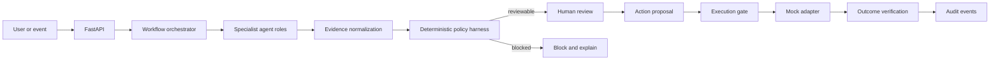

# Architecture

## Design principle
Use agents to interpret evidence and propose actions; use deterministic policy code to decide freshness, approval eligibility, expiry, tenant scope and execution. The demo is a modular monolith so those trust boundaries remain inspectable.

## Modules
- `app/domain/verticals.py`: agent roles, workflow steps, controls and pilot KPIs for all six verticals.
- `app/services/workflows.py`: deterministic workflow scaffold, freshness checks and structured output.
- `app/core/policies.py`: framework-independent policy checks.
- `app/services/actions.py`: proposal, approval, expiry and mock execution state machine.
- `app/services/store.py`: in-memory demo state only.
- `app/services/store.py` audit events are illustrative and not tamper-proof.

## Production persistence
Use PostgreSQL migrations and transactions; tenant ID on every tenant-owned row; row-level security; least-privilege roles; unique constraint on `(tenant_id, idempotency_key)`; immutable approval and execution records; JSONB for typed evidence attributes; an outbox for SIEM/workflow delivery.

## Agent graph
A later LangGraph integration should use typed workflow state and explicit human interrupt/resume nodes. The model must never decide whether policy has been satisfied; deterministic checks must gate every side effect.

## Security boundaries
Use OIDC/SSO in production; derive tenant scope from validated identity claims; enforce RBAC/ABAC for analyst/approver/operator/auditor; use allow-listed typed tools; deny arbitrary shell, SQL, browser and network operations; redact PII/PHI and secrets from prompts/traces.
